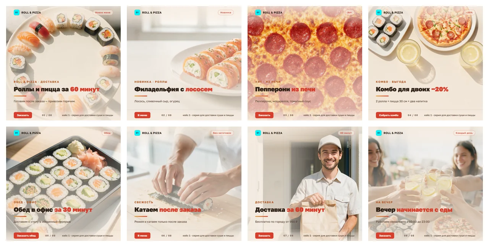
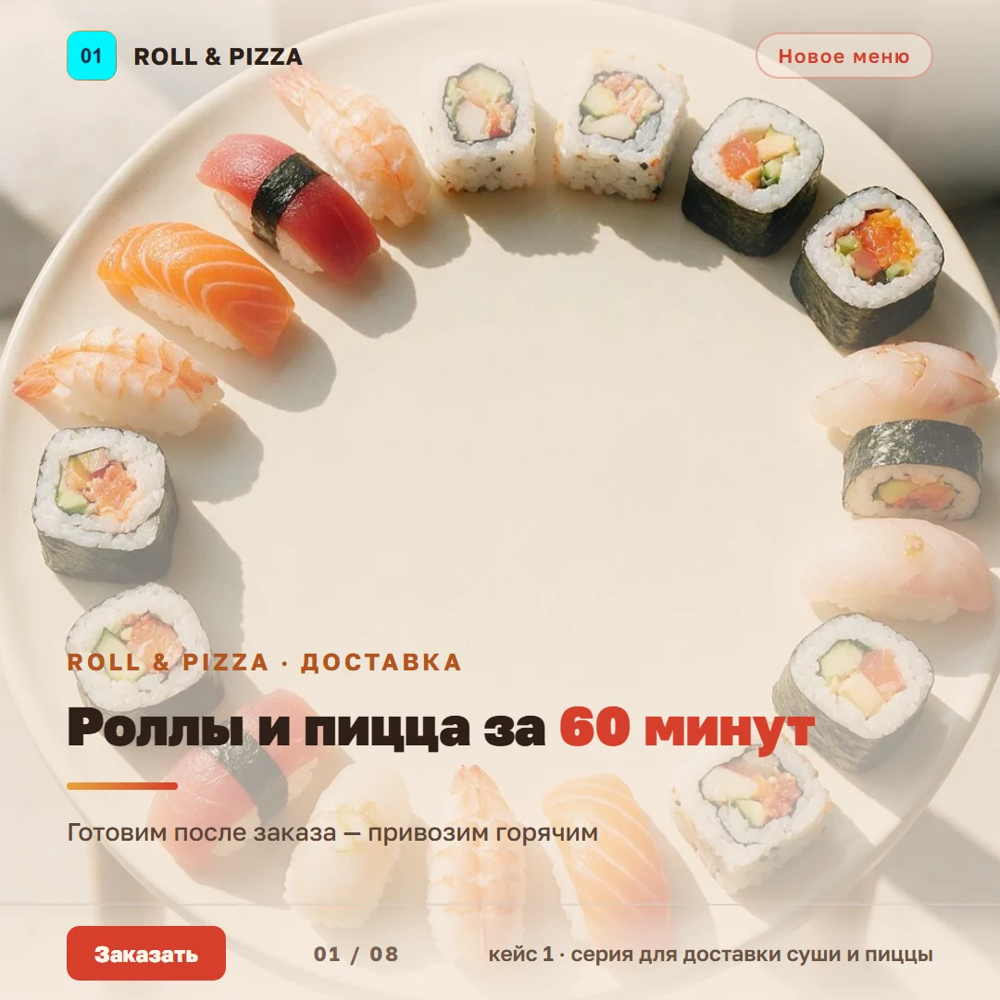
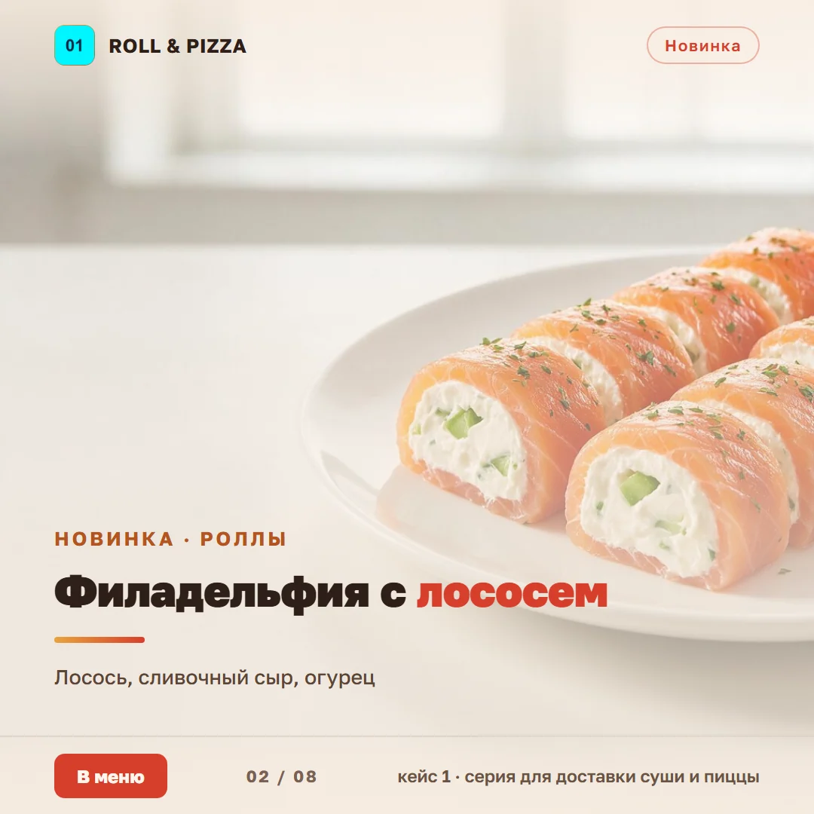
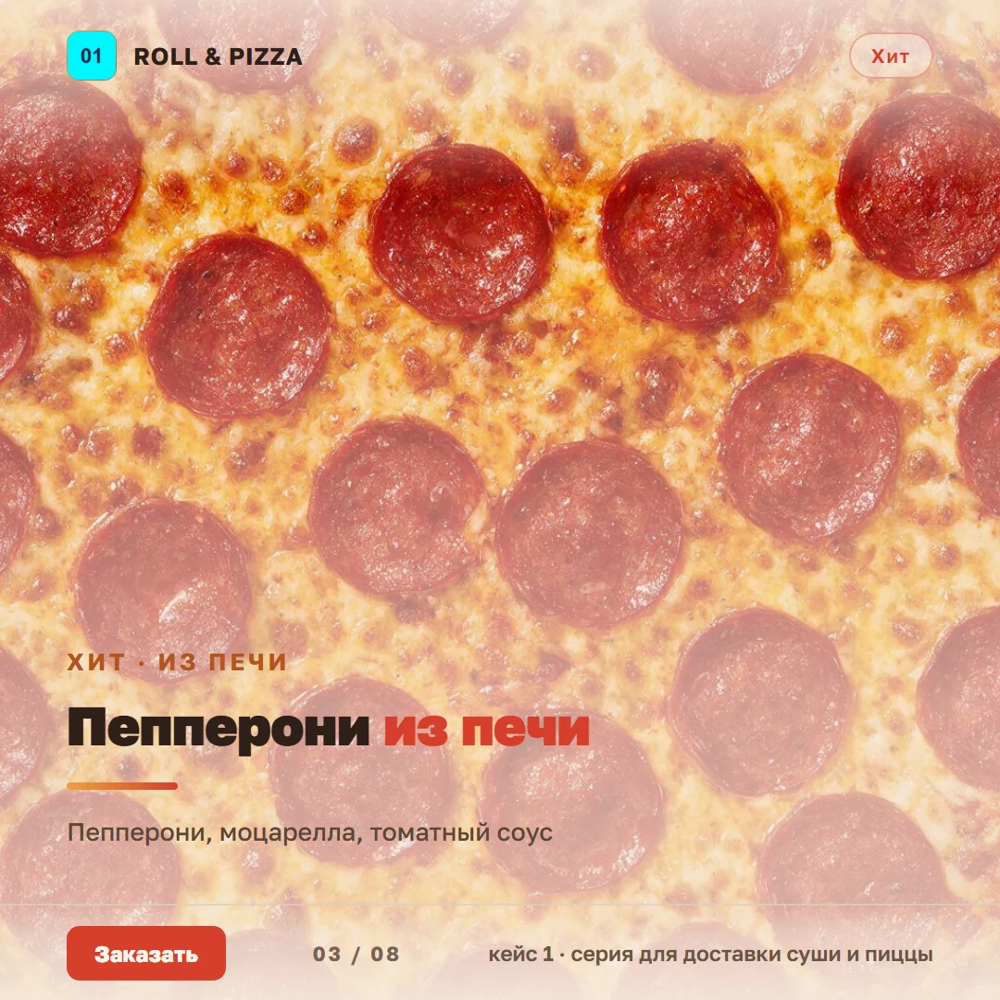
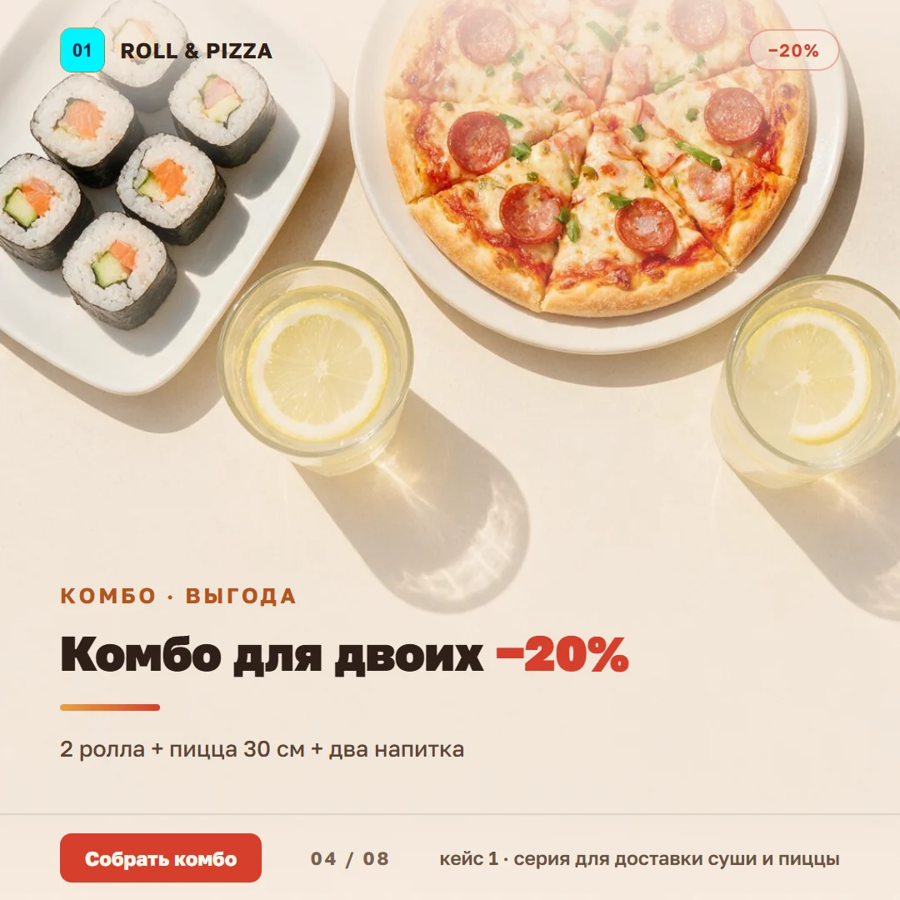
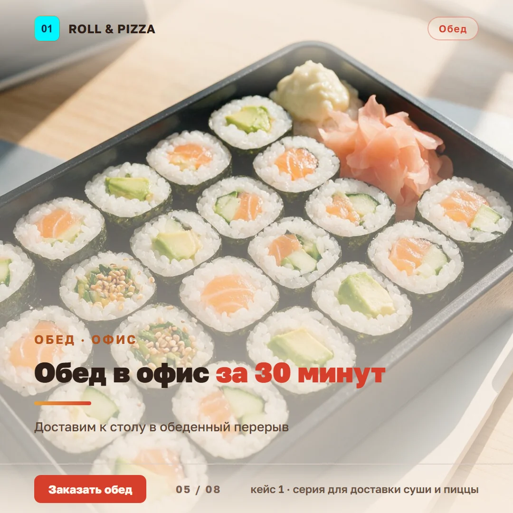
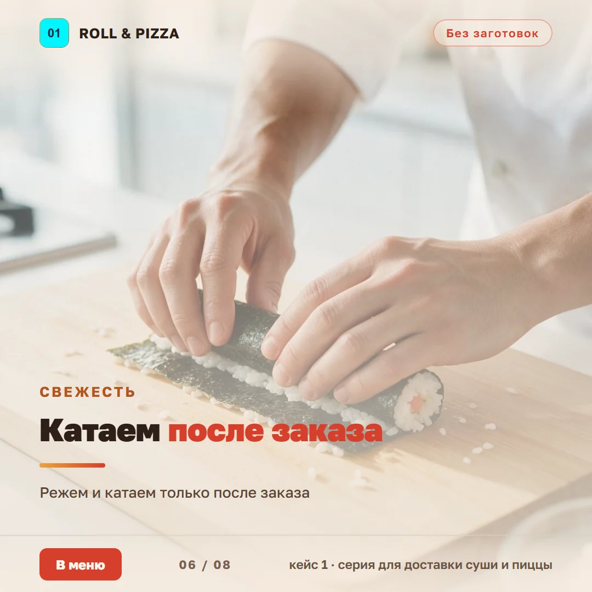
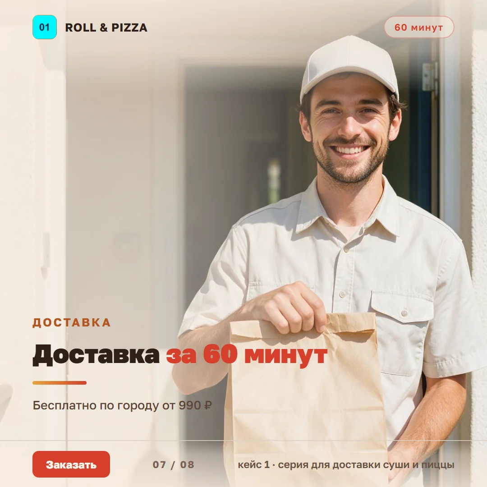
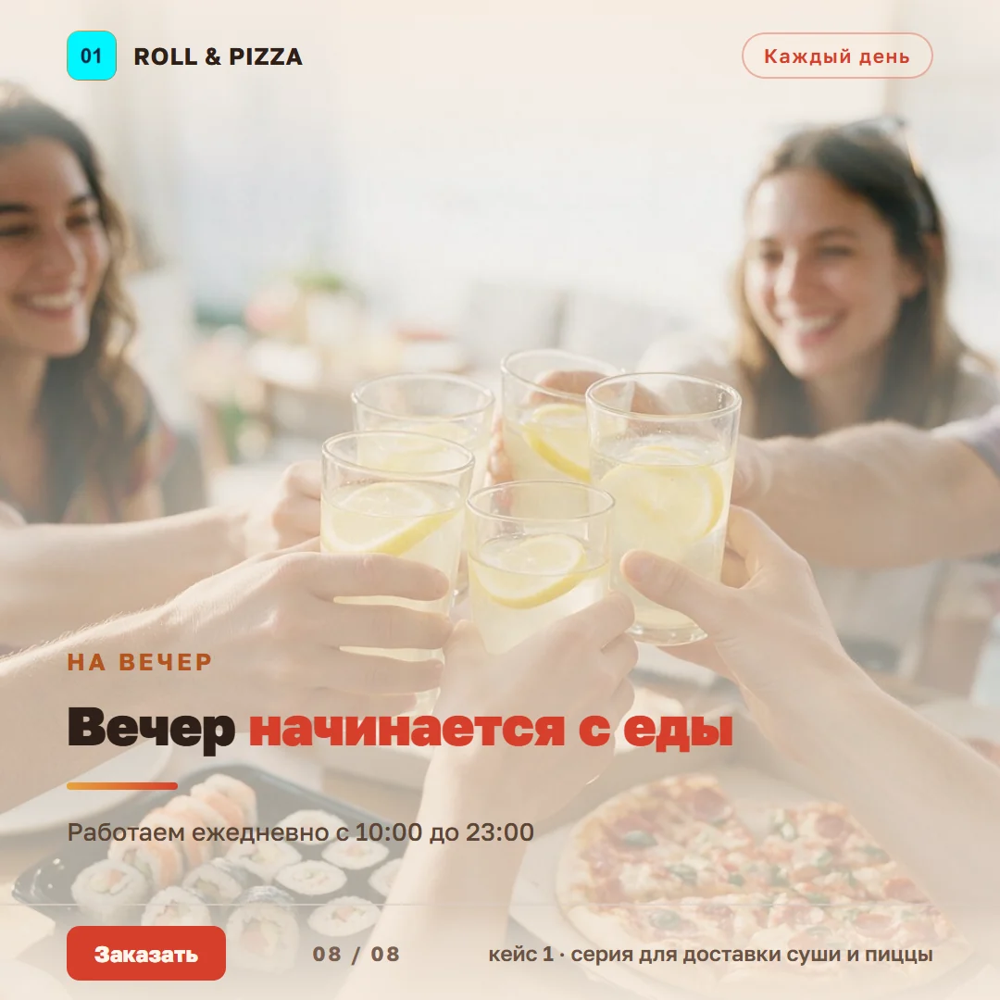

> [← Портфолио Марины Петрушиной](https://mary-rnd.github.io/portfolio/) — сайты, ИИ-боты, трекеры и автоматизация для малого бизнеса и MedTech.

# Серия визуалов для доставки роллов и пиццы — 8 постов в едином стиле

**Live:** [mary-rnd.github.io/food-visuals-series](https://mary-rnd.github.io/food-visuals-series/)

Кейс учебного задания FGg02, «Кейс 10 — Серия визуалов для соцсетей», выполненный на
основе **реального заказа с FL.ru**: вакансия «Требуется графический дизайнер» — сервису
доставки роллов и пиццы нужны карусели, посты и рекламные креативы в едином стиле бренда.

На выходе — **серия из 8 постов 1080×1080**: от обложки-обещания через продукт и комбо
до финального CTA. Один шаблон, одна палитра, общий футер с номером визуала — читается
как цельный контент для недели, а не как восемь разовых картинок.

---

## Сводный вид серии



## Визуалы

| Обложка | Продукт | Хит | Комбо |
| :---: | :---: | :---: | :---: |
|  |  |  |  |

| Обед в офис | Свежесть | Доставка | Финальный CTA |
| :---: | :---: | :---: | :---: |
|  |  |  |  |

---

## Что внутри

- **Единая сетка** — шильда бренда сверху слева, плашка-тег сверху справа, кикер
  капслоком, заголовок, линия-разделитель, подзаголовок, CTA и футер с номером
  визуала `01 / 08`. Позиции элементов одинаковы во всех восьми карточках.
- **Один сценарий на кадр** — обложка обещает, дальше идут продукт, комбо, обед,
  процесс, доставка и финальный призыв. Серия продаёт неделю контента, а не
  повторяет одно и то же.
- **Текст добавлен отдельно от генерации** — сгенерирован только фон, надписи,
  акценты и CTA наложены шаблоном после. Это требование задания и одновременно
  единственный способ получить фирменную типографику без «кракозябр» в кадре.
- **Защищённая версия для согласования** — каждая карточка есть в 720×720
  с водяным знаком «НА СОГЛАСОВАНИЕ · НЕ ДЛЯ ПУБЛИКАЦИИ»: клиенту уходит превью,
  исходники 1080×1080 — после оплаты.
- **Адаптив сериала** — те же 8 визуалов ложатся в карусель, ленту постов
  и рекламный креатив без перевёрстки: меняется только порядок.

## Палитра

Один тёплый набор на всю серию — кремовая подложка под текстом, томатный акцент,
янтарный для разделителя, графитовый текст.

| Роль | Цвет | HEX |
| --- | --- | --- |
| Подложка / фон | тёплый кремовый | `#F7ECE0` |
| Акцент, CTA-плашка | томатный | `#D63E2C` |
| Вторичный акцент | янтарный | `#E8A33D` |
| Текст заголовков | графит | `#2E2018` |
| Подзаголовок | тёплый серо-коричневый | `#5C4636` |

Плотность подложки снижена по сравнению с дефолтной (`.74 / .64 / .34` вместо
`.97 / .90 / .55`): фото внизу остаётся видимым, а контраст текста держится на
уровне **4.9–6.7:1** (норма WCAG AA — 4.5:1).

## Инструменты

| Этап | Что делалось |
| --- | --- |
| Заказ | Разбор вакансии с FL.ru: задача, ЦА, форматы, сроки, недостающие данные |
| Бриф | 10 полей визуальной концепции + уточняющие вопросы к клиенту |
| Промт | Структура «объект → стиль → формат → детали», 8 промтов под кадр |
| Фон | `bytedance-seed/seedream-5-0-pro` через ProxyAPI, 1024×1024 |
| Сборка | HTML/CSS-шаблон → headless Chrome: текст, акценты, CTA, чип, футер |
| Защита | Превью 720×720 с водяным знаком |

Генерация шла **без фирменной подмешки** промта (флаг `--no-brand`) — иначе
нейросеть дописывает в кадр чужую палитру и уводит фото в холодную синеву.

## Процесс и стоимость

| Показатель | Значение |
| --- | --- |
| Визуалов | 8 постов 1080×1080 |
| Время работы | 3 ч 20 мин |
| Стоимость по кейсу | 15 000 ₽ (3 500 ₽ за визуал) |
| Себестоимость фонов | ≈ 50 ₽ на всю серию (≈ 6 ₽ за кадр) |
| Логотип клиента | не генерировался — по правилу задания |

Дополнительно предлагаются: пакет «Визуалы на неделю» (7 постов + обложка + сториз)
и расширение серии до 10 кадров.

## Структура

```
.
├── README.md                ← этот файл
├── index.html               ← статическая галерея серии (GitHub Pages)
├── LICENSE                  ← MIT
└── screenshots/
    ├── series-overview.webp ← сводный лист 4×2 для быстрого просмотра
    ├── 01-hero.webp         ← обложка
    ├── 02-philadelphia.webp
    ├── 03-pepperoni.webp
    ├── 04-combo.webp
    ├── 05-lunch.webp
    ├── 06-fresh.webp
    ├── 07-delivery.webp
    └── 08-cta.webp          ← финальный CTA
```

## Важно

Название бренда «ROLL & PIZZA», цены и адрес — **рабочие, вымышленные**: в вакансии
не было приложено брендбука, логотипа и меню, поэтому в шаблоне стоит временный
шильда, а логотип не генерировался (генерация фирменных элементов клиента запрещена
правилами задания).

Фотофон сгенерирован специально под палитру проекта, поэтому лицензионных ограничений
не имеет. Заказ с FL.ru разобран как реальный: вакансия
[«Требуется графический дизайнер»](https://www.fl.ru/projects/5525056/trebuetsya-graficheskiy-dizayner.html),
опубликована 10.10.2026.
